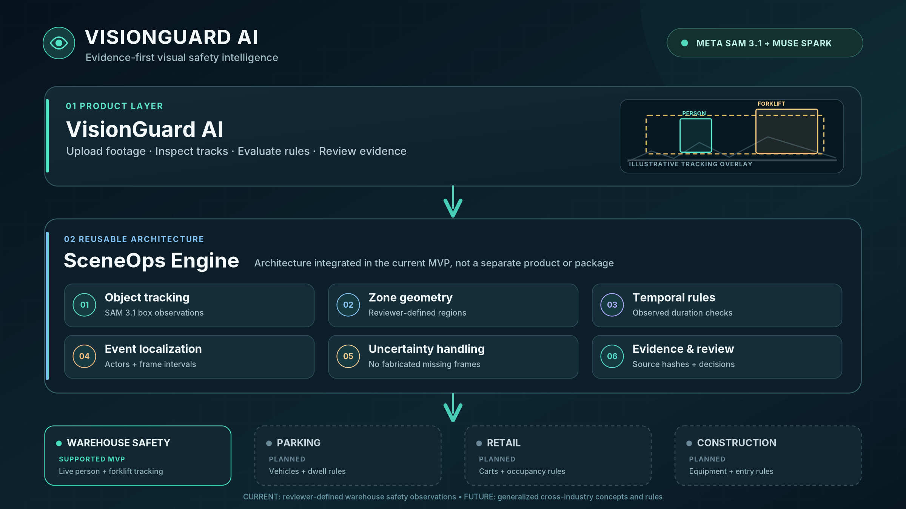

# VisionGuard AI

**Turn short workplace video into explainable observations, configurable rule matches, and human-reviewable evidence.**

[](https://dev.meta.ai/docs/cookbook/sam-api-basics)
[](https://dev.meta.ai/docs/cookbook/quickstart-chat-completions)


**Meta Global AI Developer Hackathon 2026 · Indie track**


**Watch the 3-minute 4K demonstration:** [VisionGuard AI — Hackathon Demo](https://www.youtube.com/watch?v=p-78-WtU5CY)

**Source code:** [GitHub Repository](https://github.com/El-Moatasem/visionguard-ai)

**Explore the offline demos:** Run the application locally and open `/replay` to explore six synthetic safety scenarios without model API charges.


> **Project status — November 4, 2026:** VisionGuard AI is a hackathon research MVP with video ingestion, hosted Meta SAM 3.1 integration, configurable monitoring zones, deterministic safety evaluation, human review, and evidence exports. Real SAM tracking has been successfully demonstrated on warehouse footage. Six additional offline synthetic replay scenarios demonstrate the rule engine across different safety conditions. Broader live-model reliability and accuracy have not been established.


## VisionGuard AI, powered by SceneOps



**VisionGuard AI** is the safety-review application: ingest footage, inspect tracked observations, define monitored zones, evaluate rules, and review evidence. **SceneOps** is the name for the reusable **video-to-rule architecture inside the current application**—not a separate shipped library, model, or product.

The reusable rule layer now includes **bounded object concepts and two additional deterministic operators** for parking, retail and construction demonstrations. **Real live SAM tracking remains validated only for the warehouse people/forklift clip**; the new industries have offline synthetic fixtures but need evaluation using authorized real footage before claiming accuracy.

### What works today

| Capability | Current scope |
| --- | --- |
| Video ingest & playback | Local MP4/MOV/WebM uploads, a selectable **Recent Uploads** list, browser playback, and camera capture where supported. WebM must be converted before SAM inference. |
| Hosted visual tracking | Explicit, billable Meta SAM 3.1 requests for approved concepts: **`person`, `forklift`, `car`, `shopping_cart`, `cardboard_box`, `excavator`**. The first two are verified on one real warehouse clip; others are **not live-validated**. Progressive previews and normalized tracks/gaps are available. |
| Zone-based evaluation | Reviewer-defined rectangle; legacy person/forklift rules plus **`object_in_zone`** (observed dwell) and **`object_zone_entry`** (observed outside→inside transition). The evaluator is deterministic and **offline**. |
| Muse Spark | Optional, billable natural-language drafting of a *supported* rule; human approval is required. Unsupported requests remain unsupported. |
| Uncertainty | Missing frames, approximate timing, and unverified track continuity are surfaced as review candidates rather than invented observations. |
| Evidence & review | Local evidence snapshots, source hashes, sampled boxes, reviewer decisions, and JSON / printable HTML exports. |
| Synthetic replay | **Six** offline fixtures: co-presence, occlusion, clear aisle, **parking/car dwell, retail/shopping-cart occupancy, construction/person zone entry**. These are handwritten numeric test scenes, **not real video or SAM outputs**. |
| Scenario library | Search/filter prepared scenario cards, select installed footage, and tag newly uploaded videos to a scenario. **No licensed video footage is included in the repository.** |

**Not implemented:** continuous live-camera inference, collision prediction, calibrated distance/speed estimates, certified danger detection, automated pedestrian-versus-vehicle-operator classification, three-minute dwell enforcement, or production authentication. The curated **scenario cards and imported-video picker** are implemented; the **real multi-industry footage is intentionally not bundled** and must be supplied by its rights holder.

## How it works

```text
Authorized MP4/MOV upload ──► Local video store + SHA-256
          │
          └──► Explicit "Analyze with SAM" (billable)
                        │
                  Meta SAM 3.1
        approved concepts selected per video
                        │
          Provisional streamed box previews
                        │
              Final tracking report
           boxes • track fragments • gaps
                        │
             Reviewer-defined floor zone
                   + temporal rule
                        │
          Deterministic, local evaluation
                        │
         ┌──────────────┴───────────────┐
  Observed potential match       Needs human review
         └──────────────┬───────────────┘
                        │
             Evidence snapshot +
          reviewer decisions + export
```

**Detection is not a safety verdict.** A person and forklift observed in the same drawn zone meet an image-space rule condition; this does not establish physical proximity, an imminent collision, or whether the detected person is the seated operator. Missing observations are not filled in or assumed safe. Timestamps are approximate (`frame / FPS`).

## Quick start

### Requirements

- Python **3.11+**, Node.js **20.9+**, Yarn Classic or npm, and Git.
- **FFmpeg and FFprobe** available on your `PATH` for billable video preflight and demo-clip preparation.
- A Meta Models API key (`MODEL_API_KEY`) for optional live SAM/Muse requests. **Offline tests and synthetic replay do not require one.**
- Authorized, appropriately licensed footage; no confidential or unconsented recordings.

**1. Set up the backend** (from the repository root):

```bash
python3 -m venv .venv
source .venv/bin/activate
python -m pip install --upgrade pip
pip install -r requirements.txt
cp .env.example .env
```

Edit `.env` locally if you intend to use Meta:

```dotenv
MODEL_API_KEY=YOUR_META_MODEL_API_KEY
SAM_CONCURRENT_CONCEPTS=0
```

On a Mac using **MacPorts**, ensure FFprobe is visible (the package installer must be installed separately first):

```bash
export PATH="/opt/local/bin:/opt/local/sbin:$PATH"
command -v ffprobe
ffprobe -version
```

Install FFmpeg/FFprobe using your operating system's package manager if missing. The preflight **blocks billable tracking** without readable FPS and dimensions.

**2. Start FastAPI** (terminal 1, repository root):

```bash
source .venv/bin/activate
python -m uvicorn backend.app.main:app --host 127.0.0.1 --port 8000
```

**Do not use `--reload` during a billable SAM job.** Reloading can terminate the local worker mid-stream. For a cost-controlled single-concept test, start with `SAM_DEMO_CONCEPTS=person` in front of the command. For an ordinary untagged upload, the UI defaults to **person + forklift**; selecting a parking or retail demo supplies its approved concept list. `SAM_CONCURRENT_CONCEPTS=1` enables optional parallel requests after basic integration succeeds. `SAM_DEMO_CONCEPTS` is an optional CLI/environment fallback override, but an explicit UI concept selection takes priority.

Check [Swagger API docs](http://127.0.0.1:8000/docs) or:

```bash
curl http://127.0.0.1:8000/health
curl http://127.0.0.1:8000/api/v1/meta/status
```

The Meta status route checks for a configured key; it does **not** prove account permissions, remaining credits, or model availability.

**3. Start Next.js** (terminal 2):

```bash
cd frontend
yarn install --frozen-lockfile
yarn dev --webpack
```

Open **http://localhost:3000**. The app uses a same-origin Next.js rewrite to proxy backend requests; keep API keys on the server, never in `NEXT_PUBLIC_*` variables.

### Prepare a fast, reproducible clip

The application currently supports the following default SAM analysis limits:

- Maximum SAM input size: **100 MiB** (`SAM_MAX_FILE_MIB`).
- Maximum analysis duration: **120 seconds** (`SAM_MAX_DURATION_SECONDS`).
- Maximum video frame count: **15,000 frames**.
- Supported SAM input containers: MP4 and MOV.
- Prepared clips: H.264 MP4, at most 1080p and 30 FPS.

These are application-level defaults and validation constraints, not general claims about Meta API upload limits.

For fast, cost-controlled demonstrations, shorter clips of approximately 5–10 seconds at 480p and 12 FPS are recommended. Each tracked concept can trigger a separate billable Meta model request.


```bash
# Provide your own licensed source video first.
python -m backend.scripts.prepare_demo_clips \
  --input samples/warehouse_source.mp4 \
  --output samples/warehouse_demo_480p.mp4 \
  --seconds 5 --height 480 --fps 12
```

**Upload the converted clip to the UI.** The video played in the browser must be the **same file** sent to SAM; converting only the model input would misalign bounding boxes.

### First end-to-end local demo

1. Upload and select a prepared video under **My uploads**, or choose a scenario card in **Demo & Video Library** and add an authorized clip.
2. Click **Analyze with SAM (billable)** once. The interface shows phases and may display **provisional** observations before completion.
3. After **COMPLETED**, inspect boxes, track fragments, and missing-frame gaps. A completed request with **zero detections** is a valid possible result.
4. In **Safety Intelligence**, choose/draw a zone and evaluate a supported rule. Scenario-tagged footage supplies a suggested zone and rule. **Rule evaluation is offline** and consumes no Meta credits.
5. Inspect observed potential matches and separate review items; click an event or **timeline marker** to seek to its approximate time. Only tracks involved in an evaluated match are highlighted.
6. Save an evidence snapshot, record **confirmed / rejected / unresolved** human decisions, and export JSON or HTML.

**Do not present an observed rule match as a confirmed accident.** The shared-zone rule can also match an operator in the forklift; review the actual frames before interpreting a result.

## Demo & Video Library — SceneOps

The gallery is backed by `GET /api/v1/demo/scenarios` and the existing locally persisted `GET /api/v1/videos`. **All uploads automatically enter the video list**. A scenario's **Add video** action tags that upload with its recommended concepts, duration and review zone. The real model is only called by clicking **Analyze with SAM (billable)**—never by listing or selecting a clip.

| Scenario | Concepts | Rule | Validation |
| --- | --- | --- | --- |
| Warehouse shared zone | `person`, `forklift` | Co-presence | **One real SAM clip completed** locally; broader reliability not established |
| Pedestrian / forklift | `person`, `forklift` | Co-presence | Needs a separate rights-cleared real clip and evaluation |
| Parking loading zone | `car` | `object_in_zone` (observed dwell) | Offline synthetic replay passes; **real SAM not validated** |
| Retail clearance zone | `shopping_cart`, `cardboard_box` | `object_in_zone` | Offline synthetic replay passes; **real SAM not validated** |
| Construction operating zone | `person`, `excavator` | `object_zone_entry` | Offline synthetic replay passes; **real SAM not validated** |
| Clear aisle | `person`, `forklift` | Negative co-presence control | Existing synthetic fixture |
| Occlusion review | `person`, `forklift` | Uncertainty / review | Existing synthetic fixture |

### Install your own demo videos

The repository **does not ship stock footage**. First obtain authorized short MP4s (check redistribution, facial privacy, and whether uploading to Meta is permitted). Prepare each clip with the same file used by the browser:

```bash
# From the repository root; adjust source paths to existing files.
python -m backend.scripts.prepare_demo_clips \
  --input samples/demo/raw/parking_source.mp4 \
  --output samples/demo/prepared/parking-loading-zone.mp4 \
  --seconds 8 --height 480 --fps 12

python -m backend.scripts.prepare_demo_clips \
  --input samples/demo/raw/retail_source.mp4 \
  --output samples/demo/prepared/retail-clearance.mp4 \
  --seconds 8 --height 480 --fps 12

# Register prepared clips into the same persistent library as regular uploads.
python -m backend.scripts.seed_demo_library --all

# Or import a single clip:
python -m backend.scripts.seed_demo_library \
  --scenario parking-loading-zone \
  --source samples/demo/prepared/parking-loading-zone.mp4
```

`--all` skips scenario filenames not present. Import is local and consumes no model credits. Demo footage and persisted store are gitignored; **do not delete `var/` or `.env` during updates**. Alternatively, click **Add video** on a scenario card to upload the file directly. A normal **Upload video** goes under **My uploads**.

When running live inference on a parking or retail clip, use the matching tracking mode, then approve a reviewer zone and evaluate a rule. A 2-second car dwell demonstration is a **short-clip example**, not a verified 3-minute parking violation. Image-space cart occupancy is **not proof that an aisle is physically obstructed**. Person zone entry means observed outside-to-inside image-space transition; occluded intervals remain review-only.

Go to **http://localhost:3000/replay** to try all six distinctly labeled synthetic fixtures, including car, cart, and construction examples, **without footage, a model key, or model charges**.

## Architecture and repository layout

- **Frontend:** Next.js 16, React 19, TypeScript; upload, browser playback, overlays, rule controls, and evidence review.
- **Backend:** FastAPI; local file-backed video store, job records, streaming previews, constrained model integration, deterministic evaluation, and evidence exports.
- **Model boundary:** SAM provides observations; Muse proposes a draft; **neither model is allowed to produce a final safety certification**. The deterministic rule evaluator operates on observed tracking data only.

```text
visionguard-ai/
├── backend/
│   ├── app/
│   │   ├── api/                  # video, tracking, safety, evidence, replay, demo routes
│   │   └── services/
│   │       ├── sam.py             # hosted SAM stream parsing
│   │       ├── sceneops_concepts.py  # supported noun-phrase concept registry
│   │       ├── demo_catalog.py   # predefined demo metadata
│   │       ├── tracking_jobs.py   # local background jobs + previews
│   │       ├── tracking_report.py # boxes / fragments / gaps
│   │       ├── safety_engine.py   # deterministic temporal rules
│   │       ├── evidence_store.py  # local evidence and audit history
│   │       └── replay_fixtures.py # synthetic scenario loader
│   ├── scripts/                  # smoke tests, video preparation, seeding demo library
│   └── tests/                    # offline test suite
├── frontend/                     # Next.js app (Yarn lockfile)
├── benchmarks/replay/            # labeled synthetic fixtures
├── docs/                         # implementation and architecture notes
│   └── assets/                   # README architecture illustration
├── .github/workflows/            # backend / frontend CI
├── var/                          # local uploads/jobs/evidence (gitignored)
├── samples/                      # user-provided footage (gitignored)
├── outputs/                      # generated model artifacts (gitignored)
└── .env.example
```

Further technical notes: [tracking pipeline](docs/architecture/object-tracking-pipeline.md), [temporal evaluation](docs/architecture/temporal-evaluation-v2.md), [rule engine](docs/architecture/safety-rule-engine.md), [evidence and replay](docs/architecture/evidence-review-and-replay.md), and [performance / multi-video testing](docs/13-performance-and-multi-video-testing.md),[Dynamic demo and deployment architecture](docs/architecture/visionguard-demo-architecture.md).

## API overview

| Endpoint | Purpose |
| --- | --- |
| `GET /health` | Backend health |
| `GET /api/v1/meta/status` | Local Meta key-presence check only |
| `POST /api/v1/videos` (optional `?scenario_id=`) | Store uploaded video, optionally tagged to a demo |
| `GET /api/v1/demo/scenarios` | List demo profiles, rules and default zones |
| `GET /api/v1/videos` | List recent uploads |
| `POST /api/v1/videos/{id}/tracking-jobs` | **Explicitly billable** SAM analysis; optional JSON `{"concepts":["car"]}` |
| `GET /api/v1/tracking-jobs/{id}` | Job state, phase and safe diagnostics |
| `GET /api/v1/tracking-jobs/{id}/preview` | Provisional, read-only observations (may be 404 until ready) |
| `GET /api/v1/tracking-jobs/{id}/result` | Completed normalized tracking report |
| `POST /api/v1/rules/interpret` | Optional **billable** Muse rule draft |
| `POST /api/v1/tracking-jobs/{id}/evaluate` | Offline deterministic safety evaluation |
| `/api/v1/evidence-reports` | Local evidence snapshots, reviews and exports |
| `/api/v1/replay/scenarios` | Read-only synthetic benchmarks (six fixtures) |

All endpoints that store data or trigger Meta inference are intended for **trusted local use**, not an unprotected public deployment.

## Testing and reproducibility

```bash
# Offline backend tests; do not spend model credits
python -m pytest backend/tests -q

# Local rule fixture check
python -m backend.scripts.evaluate_fixture

# Frontend checks
cd frontend
yarn typecheck
yarn build
```

The GitHub Actions workflows run backend tests and frontend typecheck/build. These checks **do not** establish live SAM accuracy, model availability, or safe behavior in a real workplace. The extended parking, retail, and construction paths were tested using offline synthetic observations only. The frontend's full build should also be run locally before merging.

Optional real Meta checks are **billable** and should use short licensed inputs:

```bash
python -m backend.scripts.meta_smoke muse
python -m backend.scripts.meta_smoke sam \
  --video samples/warehouse_demo_480p.mp4 \
  --concept person --concept forklift \
  --output outputs/live-check
```

Single-process background jobs can be interrupted by server restarts and are **not** a durable queue. Mask SVG generation is optional; the normal pipeline avoids expensive full-mask conversion. Progressive preview revisions are **not percentages**.

## Safety, privacy, and deployment

- **Research prototype only:** not certified safety monitoring, emergency response, workplace compliance verification, or continuous real-time surveillance.
- Keep `.env`, user footage, raw model outputs, local jobs, and reviewer notes out of Git. Verify clip rights and authorization before sending footage to a third-party model API.
- Local API routes have **no authentication, tenant isolation, or production abuse controls**. Do not publicly expose upload, billable inference, or persistent review endpoints.
- For an intentionally **public read-only synthetic replay**, start FastAPI with `VISIONGUARD_REPLAY_ONLY=1` and build the frontend with `NEXT_PUBLIC_REPLAY_ONLY=1`. Those flags disable the local upload/paid/review-write routes; verify your deployment configuration independently.
- Local evidence records preserve source hashes, rule parameters, sampled observations, and appended human decisions. They are **not** independently verified model outputs or tamper-proof audit records.
- Evaluate positive examples, negative controls, occlusion, model failures, and false positives before making performance claims.

## Built during the hackathon

The pre-build starter at **Oct 26 (`df6b20b`)** contained a SAM adapter, Muse connectivity, and roadmap documentation. Feature development was carried out during the hackathon build window; links below refer to the documented project history, not claims of completed safety certification.

| PR(s) | Build window | Work |
| --- | --- | --- |
| #3–4 | Oct 29 | Video ingestion, playback, mobile capture |
| #5–6 | Oct 30 | SAM tracking, fragments, observed gaps |
| #7–12 | Oct 31 | Muse rule drafting, deterministic rules, temporal handling |
| #13–14 | Nov 1 | Evidence snapshots, human reviews, synthetic replay |
| #15–17 | Nov 1–2 | Performance, progressive previews, preflight checks |

**Validation scope:** one real warehouse SAM clip, six hand-authored synthetic evaluation scenarios, and a conservative operator-candidate review mechanism. A real operator/pedestrian evaluation on the final clip must be verified before recording. Automated operator identity classification is **not** claimed.

## Hackathon disclosure

The build-window features and the pre-build starter are itemized above. Third-party video is not bundled, and the working real model demonstration must be distinguished from synthetic replay.

- [Meta Global AI Developer Hackathon](https://cerebralvalley.ai/e/meta-ai-developer-hackathon)
- [Meta SAM API basics](https://dev.meta.ai/docs/cookbook/sam-api-basics)
- [Meta Muse Spark quickstart](https://dev.meta.ai/docs/cookbook/quickstart-chat-completions)

## License

MIT applies to original repository code only. Meta models, third-party dependencies, video footage, and external media are governed by their respective terms. See [LICENSE](LICENSE).


VisionGuard AI combines original project materials with third-party stock media used for illustration and demonstration.

- **Demo video footage:** Warehouse, supermarket, parking-lot, and construction-site clips were sourced from [Pexels](https://www.pexels.com) under the [Pexels License](https://www.pexels.com/license/). The videos are not bundled in this repository.
- **Stock photography:** Illustrative images were sourced from [Unsplash](https://unsplash.com) under the [Unsplash License](https://unsplash.com/license). Photo references and candidate footage sources are documented in [Demo Media Sources](docs/DEMO_REAL_MEDIA_SOURCES.md).
- **Original project visuals:** VisionGuard AI interfaces, tracking overlays, architecture diagrams, and custom scenario illustrations were developed for this project.
- **Voiceover:** The demo narration was generated using ElevenLabs and is subject to its applicable licensing terms.
- **Background music and sound effects:** Audio used in the demonstration remains subject to its original source licenses and is not covered by the repository's MIT license.

### Media usage and limitations

- Stock footage is illustrative and does not depict verified workplace incidents.
- People, organizations, and brands appearing in stock media do not endorse VisionGuard AI.
- Synthetic replay scenarios are clearly distinguished from real Meta SAM model outputs.
- Third-party media remains subject to its original licensing terms.
- Free stock-media licensing does not automatically authorize every form of redistribution or third-party AI processing.

The MIT license applies to original repository code only and does not supersede third-party media licenses.
