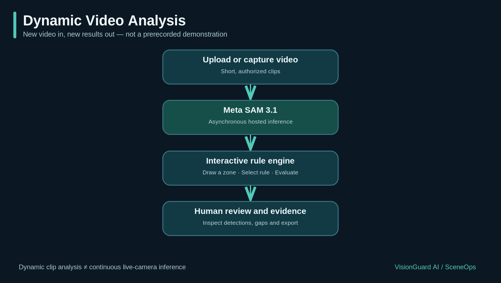
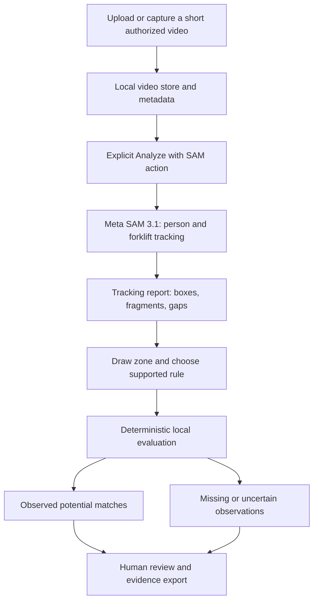
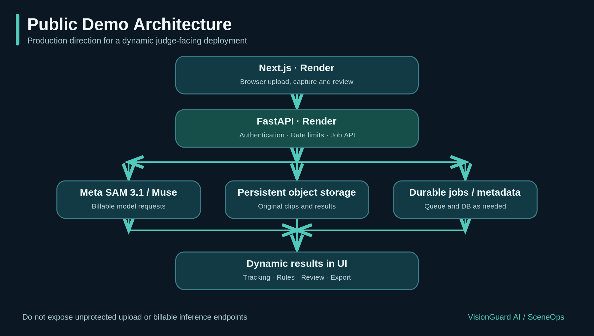
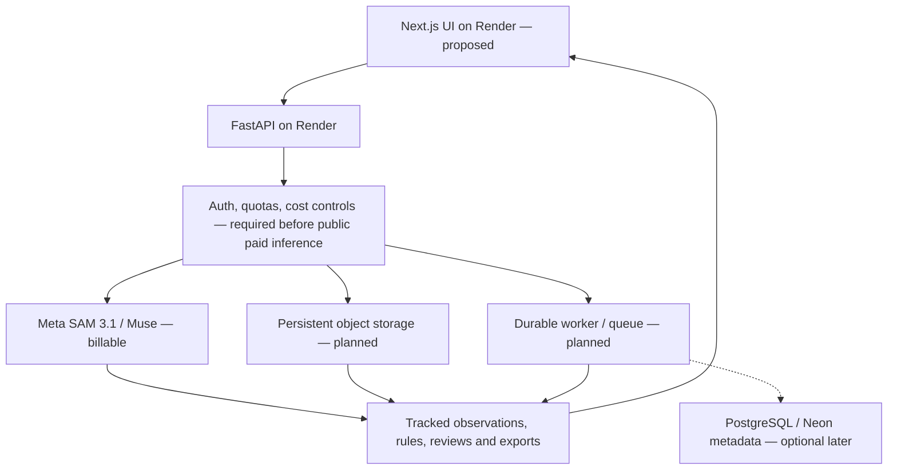

# VisionGuard AI — Dynamic Demo & Deployment Architecture

> **Status (November 2026):** This document distinguishes the current local research MVP from the **proposed public deployment**. The public-service security and persistence components shown below are **not yet implemented**. SceneOps names the architecture within VisionGuard AI, not a separately deployed service.

## 1. Dynamic video analysis — current local application



A new authorized video generates a **new analysis job and new model observations**. The workflow is interactive—not a fixed prerecorded demo—but it is **not continuous live-camera inference**. Browser camera capture records a clip first; inference runs on the recorded file only after the user deliberately starts analysis.

| Stage | What it does | Current status |
| --- | --- | --- |
| Upload or capture | Select an MP4/MOV clip or record a browser-supported short clip | Implemented locally |
| Tracking job | Explicit request to hosted Meta SAM 3.1 for `person` and `forklift` | Implemented locally; billable, API key required |
| Progressive results | Poll job status, show provisional boxes, then completed tracking data | Implemented locally; provisional results are not final |
| Rules and zones | Draw a rectangular operating zone, choose a supported rule, apply duration/gap checks | Implemented locally |
| Evidence and review | Inspect observed matches and uncertainties, record reviewer decisions, export JSON/HTML | Implemented locally |
| Driver/operator exclusion | Explicitly exclude an identified operator's track without excluding nearby pedestrians | **Pending validation / integration**; do not claim as shipped |
| Continuous live-camera analysis | Streaming inference while video is captured | **Not implemented** |

### Workflow details

1. The browser uploads a short, authorized video. The backend stores it locally with video metadata and a SHA-256 digest.
2. The reviewer explicitly selects **Analyze with SAM**; upload alone does not trigger billable inference.
3. SAM 3.1 returns tracked observations for the currently supported `person` and `forklift` concepts. Results can include missing observations and track-fragment boundaries.
4. A reviewer defines a zone and evaluates `person_in_zone` or `person_and_forklift_in_zone` with the deterministic evaluator. This evaluation does **not** require another model request.
5. The UI separates observed rule matches from unverified continuity and missing-data review items.
6. The reviewer can create an evidence snapshot, append decisions, and export the result.

<details>
<summary>Editable Mermaid source for GitHub</summary>



</details>

### Run the dynamic app locally

From the repository root, after configuring the Python environment and dependencies:

```bash
source .venv/bin/activate
python -m uvicorn backend.app.main:app --host 127.0.0.1 --port 8000
```

From a second terminal:

```bash
cd frontend
yarn install --frozen-lockfile
yarn dev --webpack
```

Open <http://localhost:3000>. A valid Meta key is needed for new hosted SAM inference; do not use `--reload` during paid jobs.

## 2. Public interactive deployment — target architecture



> **Architecture proposal, not a deployment claim.** The current API uses local, unauthenticated, process/file-backed operations. Deploying it with unrestricted uploads and a Meta key would expose user footage and billable endpoints to abuse.

| Component | Suggested role | Status |
| --- | --- | --- |
| Next.js on Render | HTTPS frontend: upload, capture, playback, rule and evidence UI | Proposed host; local Next.js UI exists |
| FastAPI on Render | Controlled uploads, validated jobs, read APIs, rule evaluation | Local API exists; public hardening pending |
| Meta SAM 3.1 + Muse | Billable tracking; optional rule-draft assistance | Local integration exists |
| Access control and quotas | Authentication or restricted judge access, per-user limits, spending budget | **Not implemented** |
| Persistent video/object storage | Keep authorized source clips and generated results across redeploys | **Not implemented** |
| Durable jobs | Queue/worker, retry and recovery semantics | **Not implemented** |
| PostgreSQL / Neon (optional) | Metadata, users, permissions, job tracking, reviews | **Not required for current MVP** |

<details>
<summary>Editable Mermaid source for GitHub</summary>



</details>

### Safest public deployment options

- **Today:** Deploy the existing read-only synthetic replay (`VISIONGUARD_REPLAY_ONLY=1` in FastAPI and `NEXT_PUBLIC_REPLAY_ONLY=1` at frontend build time). This is publicly demonstrable, but cannot accept arbitrary new uploads.
- **Dynamic public version:** Complete access controls, server-side quotas, trusted storage, worker durability, and retention policy first. Then enable restricted, short-video uploads and per-job inference on Render.
- **Neon:** Add only when persistent relational state is justified. Store video objects in object storage rather than PostgreSQL itself.

### What the judges should be told

The dynamic application processes a newly uploaded or captured clip on demand. It can display model-produced tracking observations and evaluate human-defined rules. It **does not** continuously analyze a live camera stream or establish real-world collision risk. The synthetic replay is explicitly labeled as generated test data, not recorded SAM inference.

## Related project documentation

- [SAM object tracking pipeline](object-tracking-pipeline.md)
- [Evidence, human review and synthetic replay](evidence-review-and-replay.md)
- [Safety rule engine](safety-rule-engine.md)
- [Temporal evaluation](temporal-evaluation-v2.md)

## Add a link from the repository README

Place this Markdown file at `docs/architecture/visionguard-demo-architecture.md` and both PNG assets under `docs/assets/`, then add the following to the root `README.md`:

```markdown
[Dynamic demo and deployment architecture](docs/architecture/visionguard-demo-architecture.md)
```

GitHub renders the linked PNG diagrams directly; the expandable Mermaid diagrams remain available for editing without a diagramming tool.
