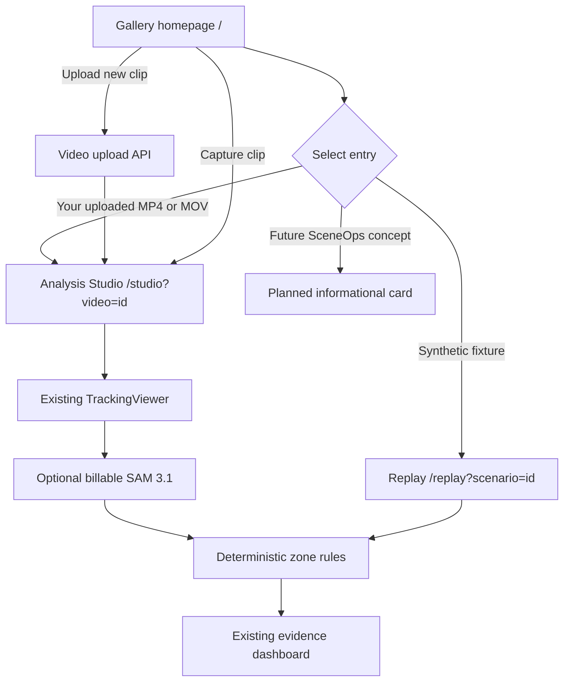

# VisionGuard AI — Gallery + Analysis Studio (B + A)

**Scope:** Local, download-only patch against the existing `El-Moatasem/visionguard-ai` repository. The package does not push, commit, or modify GitHub.

## Product layout



## Implemented in the package

- `frontend/src/app/page.tsx`: new responsive Gallery home, search, category filters, actual uploaded video cards, dynamic replay scenario cards, and clearly labeled planned concepts.
- `frontend/src/app/visionguard-gallery.css`: isolated dark-teal styles, responsive cards, dashboard hero, and self-contained **illustrative** scene artwork (not claimed as actual video or SAM output).
- `frontend/src/app/studio/page.tsx`: server-rendered route accepts `?video=<id>`, `?capture=1` and forwards selection into the Studio client.
- `frontend/src/components/VisionGuardStudio.tsx`: large analysis area with the original `TrackingViewer` (SAM jobs, zone rule evaluation and evidence review), optional camera capture, uploads, and a recent-video selector.
- `frontend/src/app/replay/page.tsx`: initial fixture is selected from `?scenario=...` after mounting; no server/client timing-dependent markup.
- `backend/app/services/tracking_jobs.py`: FFprobe lookup supports `FFPROBE_BIN` and known MacPorts/Homebrew locations, retaining existing codec/FPS/resolution/duration and billable-request guards.
- `backend/tests/test_ffprobe_lookup.py`: focused executable-resolution and metadata-read tests.
- `.github/workflows/frontend-build.yml`: switch CI from npm to Yarn Classic with Corepack.
- `frontend/next-env.d.ts`: reset tracked baseline to references that do not depend on `.next/dev` generated files.

## Route behavior

| Route | Action | Inference cost |
| --- | --- | --- |
| `/` | Dynamic Gallery / video library | None |
| `/studio` | Upload / camera / analysis workspace | Only when user explicitly starts SAM |
| `/studio?video=<id>` | Open an existing stored clip | None until SAM started |
| `/studio?capture=1` | Expand camera controls | None until SAM started |
| `/replay?scenario=warehouse-copresence` | Synthetic worker/forklift fixture | None |
| `/replay?scenario=occlusion-review` | Synthetic observation gaps | None |
| `/replay?scenario=clear-aisle` | Synthetic negative control | None |

## Important boundaries

- **Real demos are whatever videos the user explicitly uploads**. The repository currently does not bundle licensed test MP4s or recorded SAM results. No external footage is downloaded or secretly added by this package.
- Synthetic scenes are hand-authored JSON coordinates; they are never mislabeled as real recordings.
- Parking, shopping-cart, and operator-classification visualizations are **planned / test-protocol concepts** in this gallery, not implemented detector capabilities.
- Camera capture can produce WebM; the current SAM integration accepts only MP4/MOV. Conversion is still a separate preparation step. The UI says so.
- The upload endpoint supports 100 MiB; paid SAM preflight caps analysis to 25 MiB, 30s, supported codecs, and a valid FPS/dimension probe.
- The backend still has local filesystem data and no production authentication. **Do not deploy full upload and billable inference routes publicly** without authentication, rate limiting, quotas, durable jobs and storage.
- FFprobe resolver makes known installations available to FastAPI; a video with unreadable metadata still fails preflight as intended.

## Running locally

From repository root:

```bash
# Copy and apply the ZIP package outside your GitHub checkout first.
python3 /path/to/VisionGuard_Gallery_Studio_Package/apply.py --repo . --dry-run
python3 /path/to/VisionGuard_Gallery_Studio_Package/apply.py --repo .

# MacPorts install currently available at /opt/local/bin/ffprobe
# Optional override if FastAPI is launched by a GUI/IDE with a restricted PATH:
echo 'FFPROBE_BIN=/opt/local/bin/ffprobe' >> .env

source .venv/bin/activate
python -m pytest backend/tests/test_ffprobe_lookup.py -v
python -m pytest backend/tests -q
python -m uvicorn backend.app.main:app --host 127.0.0.1 --port 8000
```

Second terminal:

```bash
cd frontend
yarn install --frozen-lockfile
yarn typecheck
yarn build
yarn dev --webpack
```

**FFprobe probe before SAM:**

```bash
ffprobe -v error -select_streams v:0 -show_entries stream=width,height,avg_frame_rate,codec_name:format=duration -of json samples/my-video.mp4
```

Check `http://localhost:3000/` (Gallery), `http://localhost:3000/studio` (Analysis), and `http://localhost:3000/replay` (synthetic tests).

## UX acceptance checklist

1. Gallery loads with no uploads and no hard failure.
2. Uploading a short MP4 from Gallery opens the selected clip in Studio.
3. Recent uploads appear on Gallery cards and Studio sidebar after refresh.
4. Selecting a synthetic demo uses its exact scenario ID; analysis still runs on the real deterministic evaluator.
5. Planned industry cards have no false-positive "Run SAM" link.
6. Captured browser clip can be uploaded; if WebM, video still plays but billable SAM must reject until converted.
7. SAM analysis only begins with the explicit button in `TrackingViewer`.
8. Warehouse evaluation and human evidence review remain available unchanged in `TrackingViewer`.
9. With `VISIONGUARD_REPLAY_ONLY=1` and `NEXT_PUBLIC_REPLAY_ONLY=1`, the Gallery offers read-only replay and Studio redirects to replay.
10. `yarn typecheck && yarn build && python -m pytest backend/tests -q` pass on the user's machine.

## Suggested Git workflow (commands only — nothing pushed automatically)

```bash
git checkout develop
git checkout -b feature/gallery-analysis-studio
git status --short
# Apply patch and test as above
git add frontend/src/app/page.tsx frontend/src/app/visionguard-gallery.css frontend/src/app/studio/page.tsx frontend/src/components/VisionGuardStudio.tsx frontend/src/app/replay/page.tsx backend/app/services/tracking_jobs.py backend/tests/test_ffprobe_lookup.py docs/architecture/gallery-analysis-studio.md
git commit -m "feat(ui): introduce gallery homepage and video analysis studio"
# Push/create PR only after you explicitly decide to do so.
```

The package's Markdown documentation is copied to `docs/architecture/gallery-analysis-studio.md` by the installer.
